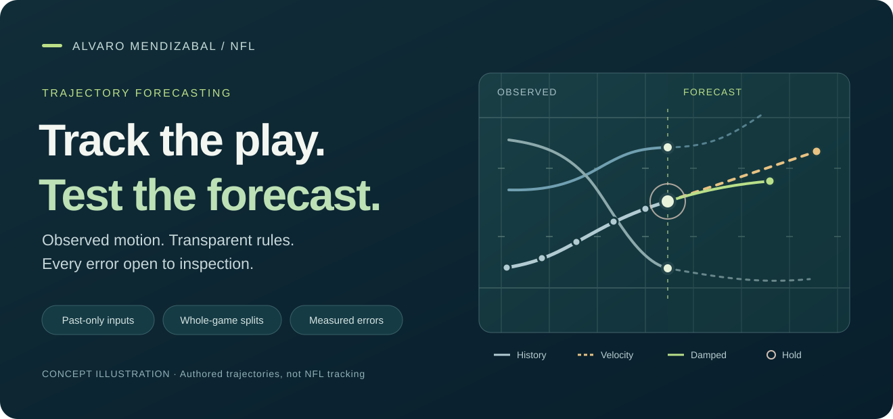

# NFL player trajectory forecasting

**Temporal modeling · game-aware evaluation · inference engineering**



A completed trajectory-forecasting system with a **20-model neural ensemble**,
audited game-held-out evaluation, and prediction-preserving inference acceleration.
The public repository exposes the data, evaluation and recovery contracts, a small
trainable reference control, and a local-first interactive demonstration.

| Recorded result | Scope |
|---|---|
| **0.46468 private coordinate RMSE** | Final late submission 56928100; no official placement claimed |
| **0.4629258204 supported OOF** | 561,607 rows across 272 games |
| **0.5242026277 complete OOF** | All 562,936 rows, including difficult unsupported cases |
| **4.784× inference acceleration** | Fixed 20-model workload, 96 plays, 3,723 rows; exact prediction parity |

[Case study](docs/EMPLOYER_CASE_STUDY.md) · [Results](docs/RESULTS.md) ·
[Model card](docs/MODEL_CARD.md) · [Run and verify](docs/REPRODUCIBILITY.md) ·
[Route Lab](https://alvaro-nfl-route-lab.tartmacaw2.chatgpt.site)

## Inspect the work

The evaluation distinguishes missing-population error from model quality, aligns
all four forecast identifiers, and pools squared errors before taking a square root.
The native reference tests exercise fitted numerical controls, geometric invariance,
missing-role fallback, invalid input rejection, and recoverable artifact writes.
The browser and Python reports expose every synthetic trajectory and export their
inputs and results for independent recomputation.

```bash
python3 -S review/run.py --output artifacts/review --with-node
python3 -S review/run.py --output artifacts/review --with-node --check
```

Python 3.11+ and Node.js are sufficient for this public review. Open the generated
`index.html` for the implementation map and `forecast-diagnostics.html` for keyed
trajectory and whole-game comparisons. No account, GPU, cloud space or raw NFL data
is needed. The [full package checks](docs/REPRODUCIBILITY.md) additionally exercise
the fitted reference and organizer-data contracts in the committed environment.

## Repository map

| Path | What it contributes |
|---|---|
| `src/nfl_trajectory/models.py` | Small fitted motion reference and observation-only prediction |
| `src/nfl_trajectory/final_evaluation.py` | Exact keyed scoring and whole-game resampling |
| `src/nfl_trajectory/data.py` | Organizer input audit, safe download and schema checks |
| `src/nfl_trajectory/runtime.py` | Atomic artifacts, source signatures and verified stage reuse |
| `public-demo/` | Interactive observed-motion forecasts on authored examples |
| `review/` and `tools/` | Source-bound walkthrough, independent CSV audit and browser tests |
| `docs/results/` | Final-system aggregates and the explicitly separate public reference |

## Publication boundary

The public control is **not the final neural ensemble**. The final neural weights,
exact ensemble recipe, private forecast arrays and competition data are not
distributed. Synthetic reference scores do not estimate the private score. Original
measurements retain their population and late-evaluation qualifications.
[Source attribution](docs/SOURCES.md) distinguishes adapted architecture references
from this project's integration, evaluation, optimization and delivery work.
